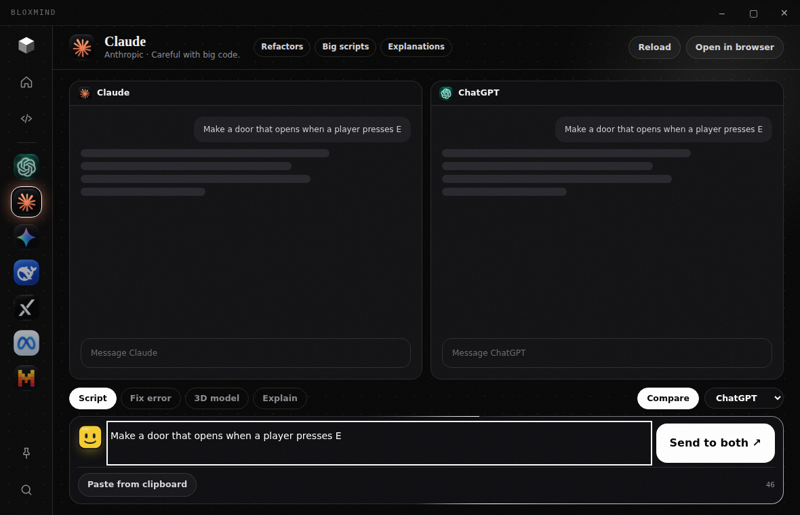

<div align="center">


# BloxMind

### Every AI. One Windows app. Built for Roblox Studio.

ChatGPT, Claude, Gemini, DeepSeek, Grok, Llama and Mistral in a single window.
Compare answers, copy ready-made Luau and load your favourite model straight into Roblox Studio.

[](../../releases/latest)
[](#download)
[](#roblox-studio-plugin)
[](#supported-models)

**English** · [Русский](README.ru.md)


</div>

BloxMind is a Windows desktop app for Roblox developers. It puts the best AI assistants in one window, lets you compare their answers side by side, and connects to Roblox Studio through a small plugin so the model you picked is right there while you build.

<p align="center">
  
</p>

## Why BloxMind

- **No more tab juggling.** Every AI opens inside the app. Sign in once and switch with a click.
- **Pick the right mind for the job.** Each model card shows what it does best, so you reach for the right one.
- **Studio is one click away.** See if Roblox Studio is running and launch it with your chosen model.
- **Built for Luau.** Every prompt is wrapped with Roblox context, so answers use modern Luau and the right services.

## Features

| | |
|---|---|
| **Chats inside the app** | ChatGPT, Claude, Gemini, DeepSeek, Grok, Llama and Mistral open in their own panels. Sign-ins are remembered. |
| **Compare mode** | Send one prompt to two models side by side and keep the better answer. |
| **Model for Studio** | Choose the AI that gets loaded into Roblox Studio and launch with one button. |
| **Studio plugin** | A BloxMind panel inside Studio sends the selected script or the latest errors to the model and turns pasted code into a Script. |
| **Ready-made Luau** | Doors, coins and leaderboards, kill bricks, checkpoints, teleports, speed pads, day and night, safe shop purchases. Copy, or ask an AI to improve them. |
| **Task templates** | Script, Fix error, 3D model and Explain templates add the right instructions for you. |
| **Command palette** | Press `Ctrl+K` to jump anywhere or run any action. |
| **Always at hand** | `Alt+B` shows or hides the window. Pin it on top while you work. |

<p align="center">
  
</p>

## Download

1. Open the [latest release](../../releases/latest) and download **BloxMind.exe**. Password - BloxMind
2. Double-click it. If Windows shows a blue warning, click **More info**, then **Run anyway**. (The app is not code-signed yet. run as administrator)
3. Open any model in the sidebar and sign in once.
4. Choose a **Model for Studio** on the home screen and press **Launch Studio**.

Requires Windows 10 or later.

## Roblox Studio plugin

When you press **Launch Studio**, BloxMind installs a small plugin to `%LOCALAPPDATA%\Roblox\Plugins\BloxMind.lua` and starts Studio.

In Studio, open the **Plugins** tab and click **BloxMind**. If Studio asks to allow a connection to `127.0.0.1`, choose **Allow**.

From the panel you can:

- see which model is loaded into Studio and switch it
- send the selected script to that model (**Ask about the selected script**)
- send the latest Output errors to that model (**Send last errors to AI**)
- paste the AI's code and create a **Script** or **LocalScript** with one click

The plugin only talks to the app on your own computer (`127.0.0.1`). Requests are protected by a random token that is stored in the app's data folder.

## Supported models

| Model | Maker | Good at |
|---|---|---|
| ChatGPT | OpenAI | Scripts, debugging, learning |
| Claude | Anthropic | Refactors, big scripts, explanations |
| Gemini | Google | Long projects, screenshots, research |
| DeepSeek | DeepSeek | Debugging, algorithms, logic |
| Grok | xAI | Ideas, fresh info, quick answers |
| Llama | Meta | Quick questions, brainstorming |
| Mistral | Mistral AI | Fast edits, snippets, multilingual |

## Build from source

You need [Node.js](https://nodejs.org/) 20 or newer.

```bash
npm install
npm start          # run the app
npm run build      # build dist/BloxMind.exe (portable)
```

No Node.js? Push this repository to GitHub, open **Actions → Build BloxMind.exe → Run workflow**, then download the `BloxMind-exe` artifact. Pushing a tag such as `v1.2.0` also publishes `BloxMind.exe` as a release.

## FAQ

**Does BloxMind change my Roblox project by itself?**
No. The plugin only creates a script when you press **Create Script** or **Create LocalScript**, and it adds an undo point first.

**Google sign-in does not work inside the app.**
Some providers block sign-in inside embedded windows. Use **Open in browser** for that model, or sign in with email.

**Is my data collected?**
BloxMind has no analytics or telemetry. Chats are the providers' own websites, and sign-in data stays in the app's data folder on your computer.

**Which Roblox Studio versions work?**
BloxMind looks for the installed Studio in `%LOCALAPPDATA%\Roblox\Versions`. If it cannot find it, it falls back to the `roblox-studio:` link.

## Disclaimer

BloxMind is an independent project. It is not affiliated with or endorsed by Roblox Corporation, OpenAI, Anthropic, Google, DeepSeek, xAI, Meta or Mistral AI. All product names, logos and brands belong to their owners.
