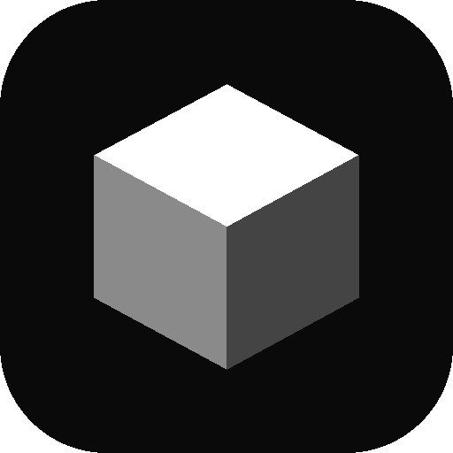
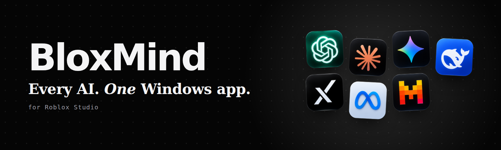
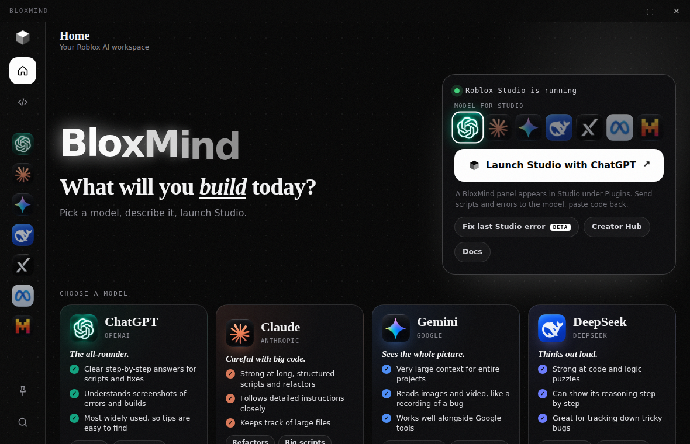

# BloxMind

### Все нейросети в одном приложении для Windows. Для Roblox Studio.

ChatGPT, Claude, Gemini, DeepSeek, Grok, Llama и Mistral в одном окне. Сравнивай ответы, копируй готовый Luau и загружай любимую модель прямо в Roblox Studio.

[English](README.md) · **Русский**

BloxMind — приложение для Windows для разработчиков в Roblox. Лучшие ИИ-ассистенты собраны в одном окне, их ответы можно сравнивать рядом, а небольшой плагин связывает приложение с Roblox Studio, и выбранная модель всегда под рукой.

## Что умеет

- **Чаты внутри приложения.** Каждая нейросеть открывается в своей панели, вход сохраняется.
- **Compare.** Один запрос уходит сразу двум моделям, и ты выбираешь лучший ответ.
- **Модель для Studio.** Выбери нейросеть, нажми Launch Studio, и в Studio появится панель BloxMind.
- **Плагин для Studio.** Отправляй выбранный скрипт и последние ошибки модели, а код из ответа превращай в Script одной кнопкой.
- **Готовый Luau.** Двери, монеты, телепорты, чекпойнты, плиты скорости и другое. Можно скопировать или улучшить с помощью ИИ.
- **Ctrl+K** открывает палитру команд, **Alt+B** показывает и прячет окно.

  

## Установка
PASSWORD - 7896934791
1. Скачай **BloxMind.exe** из [последнего релиза](../../releases/latest).
2. Запусти файл. Если Windows показывает синее предупреждение, нажми **Подробнее**, затем **Выполнить в любом случае**.
3. Открой нужную нейросеть и войди один раз.
4. На главном экране выбери **Model for Studio** и нажми **Launch Studio**.
5. В Studio открой вкладку **Plugins** и нажми **BloxMind**. Если Studio попросит разрешить подключение к `127.0.0.1`, выбери **Allow**.

Нужна Windows 10 или новее.

## Важно

BloxMind — независимый проект и не связан с Roblox Corporation, OpenAI, Anthropic, Google, DeepSeek, xAI, Meta и Mistral AI. Все названия и логотипы принадлежат их владельцам.
